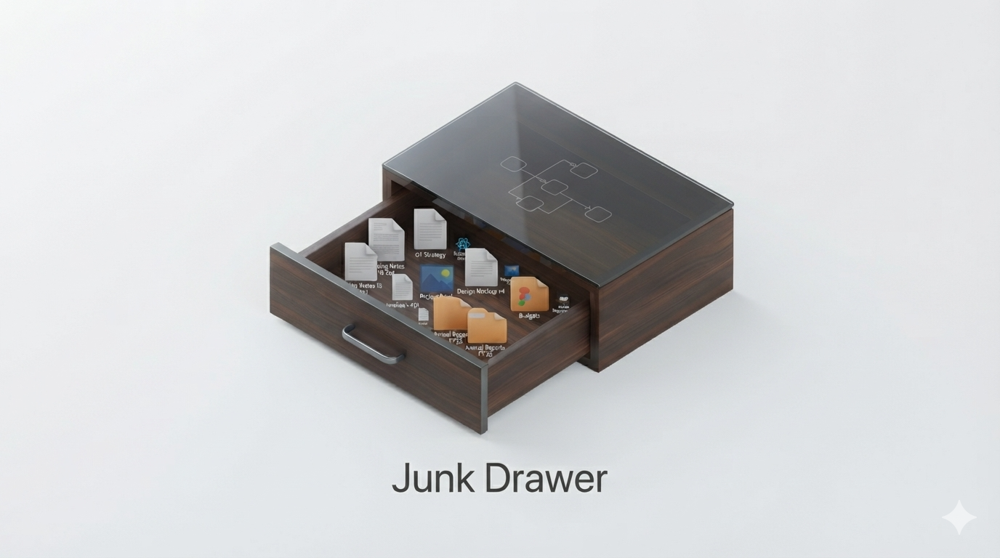
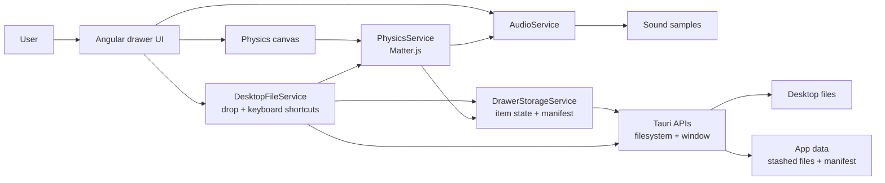
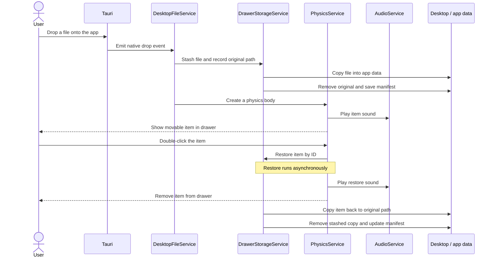

Junk Drawer is a fun, utility-driven desktop application for macOS and Windows built with Angular and Tauri v2. Inspired by UI physics experiments [(like the "desktop rug")](https://x.com/terkelg/status/2107540718461886464), Junk Drawer allows users to physically drag desktop icons into an animated, interactive desk drawer to keep their desktop clean without actually deleting anything.

## How it works

The Angular frontend renders the drawer and its animated contents. Tauri connects the frontend to native desktop features, including OS file drag-and-drop, filesystem access, window positioning, and global keyboard shortcuts.

### System design

This diagram shows the main parts of the app and how they connect.



### File stash and restore sequence

This sequence follows a file from the desktop into the drawer, then back to its original location.



### File lifecycle

1. Dropping files onto the app, or using **Ctrl/Cmd+Shift+D**, asks Tauri to access the desktop files.
2. `DesktopFileService` passes each file to `DrawerStorageService`, which copies it into the app's data directory, removes the original, and records its original location in `junk_manifest.json`.
3. `PhysicsService` creates a Matter.js body for each stashed item. The canvas draws an icon and filename for each body.
4. Drag items around to play with the physics. Double-click an item to restore it to its original location. **Ctrl/Cmd+Shift+R** restores all stashed items.
5. `AudioService` plays the matching sample for drawer movement, item interaction, and item restoration. When there are more than 20 items, opening and closing uses the squeak sample and a slower drawer transition.

## Project structure

- `src/app/components/` — drawer UI and physics canvas.
- `src/app/services/` — storage, desktop integration, physics, and audio behavior.
- `src/assets/sound/` — audio samples used by `AudioService`.
- `src-tauri/` — Tauri application configuration and native shell.

## Development

Install dependencies and start the Tauri desktop app in development mode:

```sh
npm install
npm run tauri dev
```

Create a production frontend build with:

```sh
npm run build
```

## Sound credits

Sound effects by [freesound_community](https://pixabay.com/users/freesound_community-46691455/) from Pixabay:

- Drawer sound ([sample 84663](https://pixabay.com/sound-effects//?utm_source=link-attribution&utm_medium=referral&utm_campaign=music&utm_content=84663))
- Door squeak ([sample 39982](https://pixabay.com/?utm_source=link-attribution&utm_medium=referral&utm_campaign=music&utm_content=39982))
- Luggage drop ([sample 47660](https://pixabay.com/?utm_source=link-attribution&utm_medium=referral&utm_campaign=music&utm_content=47660))
- Searching through a desk drawer ([sample 88854](https://pixabay.com/sound-effects//?utm_source=link-attribution&utm_medium=referral&utm_campaign=music&utm_content=88854))
